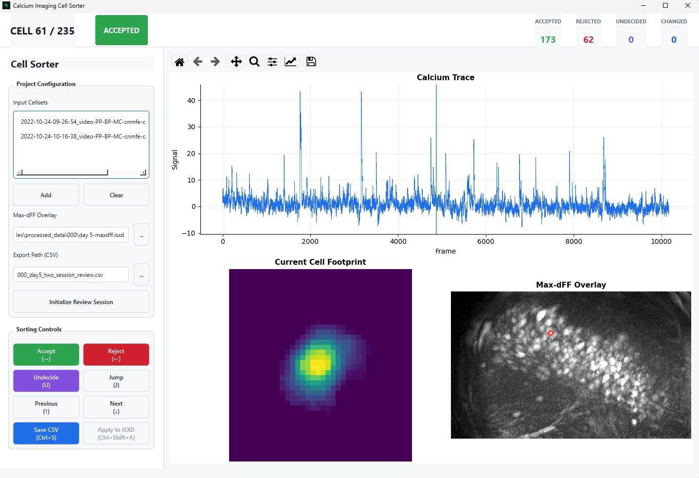

# Calcium Imaging Cell Sorter

Small standalone desktop GUI for reviewing Inscopix cellset `.isxd` files.


Use it to open one or more cellsets, inspect each cell image, max-dFF overlay, and calcium trace, then save accepted/rejected/undecided decisions to a sidecar CSV and ISXD files.

## Install

From the package directory:

```powershell
uv sync --extra test
```

Python 3.10 or newer is required. The install includes the public PyPI `isx` package from Inscopix/pyisx, so the app can read `.isxd` files directly.

## Launch The GUI

Start the desktop app:

```powershell
uv run calcium-cell-sorter
```

Then choose your input files in the GUI:

1. Add one or more cellset `.isxd` files that were processed together and contain the same identified cells.
2. Choose the matching max-dFF `.isxd` image for those sessions.
3. Choose an output CSV path.
4. Click **Initialize Review Session**.
5. Sort cells using the on-screen buttons or keyboard shortcuts, then click **Save CSV**.

The app rejects arbitrary pairings. Multi-session cellsets must contain the same identified cells and share the same field of view. The max-dFF image must match that same field of view, and any day metadata that is present must agree.

Only click **Apply to ISXD** when you intentionally want to write the current statuses back into the selected `.isxd` files.

## Python API

Other Python scripts can launch the GUI through a simple input schema instead of building CLI arguments:

```python
import sys
from calcium_imaging_cell_sorter import ReviewInputs, launch_review

inputs = ReviewInputs.from_paths(
    ["path/to/session-a-cellset.isxd", "path/to/session-b-cellset.isxd"],
    maxdff_file="path/to/day-5-maxdff.isxd",
    output_csv="path/to/review.csv",
    read_only=True,
)

sys.exit(launch_review(inputs=inputs))
```

This package expects the caller script to decide which files belong together. The GUI validates that the selected cellsets share the same identified cells and that the max-dFF image matches the same field of view.

## Launch With Files Preselected

You can also open files directly from the command line:

```powershell
uv run calcium-cell-sorter --cellset path\to\session1-cellset.isxd --maxdff path\to\matching-maxdff.isxd
```

Repeat `--cellset` to load more than one cellset in the same review session. If `--output` is not provided, the app creates a default CSV path next to the first cellset file.

Useful options:

- `--output path\to\review.csv` writes the sidecar CSV to a specific location.
- `--read-only` disables writing status changes back into the `.isxd` files.
- `--check-only` validates the `.isxd` inputs without opening the GUI.

## Output CSV

Columns:

- `cell_index`
- `original_status`
- `status`
- `changed`
- `saved_at`
- `cellset_files`
- `maxdff_file`

## Shortcuts

The review buttons also show these shortcuts:

| Action | Shortcut |
| --- | --- |
| Accept and move forward | `→` |
| Reject and move forward | `←` |
| Mark undecided and move forward | `U` |
| Previous cell | `↑` |
| Next cell | `↓` |
| Jump to cell number | `J` |
| Save CSV | `Ctrl+S` |
| Apply to ISXD | `Ctrl+Shift+A` |

### Plot Navigation

The review panel includes a standard Matplotlib toolbar at the top:
- Use the **Pan tool** (crossed arrows) to scroll through long calcium traces.
- Use the **Zoom-to-Rectangle tool** (magnifying glass) to inspect specific spikes.
- Use the **Home button** to reset the view.

## Test

```powershell
uv run pytest
```
